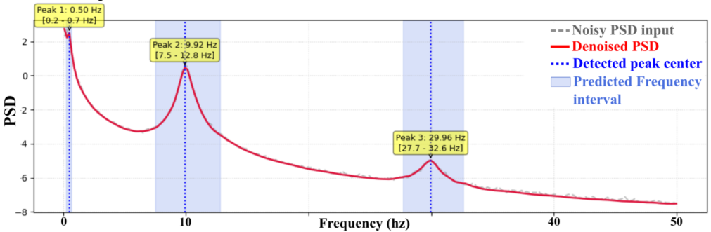

# Generation and Deep-Learning Segmentation of Oscillatory Bands in Neural Power Spectra

## Overview

Transient narrow-band oscillatory bursts in neural recordings (such as EEG and LFP) appear as spectral peaks superimposed on an aperiodic $1/f^{\chi}$ power-law background. Downstream tasks—including band-pass filtering, time-frequency burst segmentation, and spectral artifact correction—require knowing the exact frequency interval supporting each peak. However, steep background slopes, estimator variance, and drifting peak frequencies under anesthesia or pathology make fixed canonical bands ($\delta, \theta, \alpha, \beta, \gamma$) and standard parametric fits (e.g., FOOOF/specparam) unreliable.

This repository implements a **three-stage, band-agnostic framework** that learns local spectral morphology to objectively segment oscillatory frequency bands in a single forward pass:

1. **Synthetic PSD Generative Model:** Simulates realistic neural power spectral densities combining aperiodic $1/f^{\chi}$ backgrounds (with or without a spectral knee), four peak line-shape families (including the Lorentzian spectrum of a burst-generating 2D Ornstein-Uhlenbeck process), optional asymmetric post-peak tails, and multiplicative Gamma noise matching Welch's periodogram averaging.
2. **Deterministic Reference Band Segmentation:** Extracts reproducible ground-truth frequency intervals on clean PSDs using midpoint partitioning, local asymmetric Whittaker baseline smoothing, topographic prominence detection, and power-ratio boundary refinement.
3. **neural Network model:** Takes a single noisy log-PSD and jointly predicts:
   * The **denoised log-PSD**
   * A **Gaussian keypoint heatmap** of peak centers ($\hat{H}$)
   * **Dense left and right band boundary distances** ($\hat{D}_L, \hat{D}_R$)

Example of inference output on noisy PSD input:

---

## Key Features & Benchmark Highlights

* **Band-Agnostic Generalization:** Restricted effective receptive field ($\approx 5\text{ Hz}$) prevents overfitting to global spectral priors, enabling detection even when rhythms shift outside canonical bands.
* **Single Forward Pass Inference:** Requires no iterative optimization, initialization, or prior specification of peak counts.
* **Superior Robustness vs. FOOOF:** Evaluated on synthetic general anesthesia benchmarks across progressive Welch noise levels ($K_{\text{seg}} \in \{40, 20, 10, 5\}$) and validated on empirical general anesthesia EEG recordings from **VitalDB**:
  * Maintains peak detection $F_1 \approx 0.86$ under severe noise ($K_{\text{seg}} = 5$), compared to FOOOF dropping to $F_1 \approx 0.62$.
  * Reduces continuous log-PSD reconstruction RMSE by **30–35%** across all noise tiers.
  * Recovers low-frequency $\delta$ peaks ($\approx 1\text{ Hz}$) missed by global knee fits while suppressing spurious high-frequency false positives.

---

## Methodology Pipeline

### 1. Synthetic Power Spectrum Decomposition
Clean spectra are constructed on a canonical grid ($[0.1, 50]\text{ Hz}$, $N = 250$ bins, $\delta f \approx 0.2\text{ Hz}$) as:

$$P_{\text{clean}}(f) = P_{\text{bg}}(f) + \sum_{k=1}^{K} P_{\text{peak}, k}(f)$$

* **Aperiodic Background ($P_{\text{bg}}$):** Power-law decay $b_{\text{amp}} / f^{\chi}$ with an optional low-frequency knee $f_{\text{knee}}$.
* **Peak Line Shapes:** Drawn equally from **2D Ornstein-Uhlenbeck (Lorentzian)**, **Pseudo-Voigt**, **Pearson Type IV**, and **Student-$t$** distributions, with an optional asymmetric post-peak relaxation tail.
* **Welch Noise & Grid Resampling:** Interpolated onto variable observation grids ($N_{\text{obs}} \in [80, 350]$), corrupted with multiplicative Gamma noise $\xi(f) \sim \Gamma(K_{\text{seg}}, K_{\text{seg}}^{-1})$, and resampled back to the canonical grid.

### 2. model Architecture
* **Backbone:** Shallow backbone 1-D U-Net with three output branches.
* **Loss Objective:** Jointly optimizes smooth-$L_1$ spectrum amplitude + first/second derivative losses ($\mathcal{L}_{\text{spec}}$), penalty-reduced focal loss for center heatmaps ($\mathcal{L}_{\text{heat}}$), and masked smooth-$L_1$ / $L_2$ boundary distance regression ($\mathcal{L}_{\text{width}}$).

---

## Contact

The current repository will be the object of a patent and a research article in the months to come. 
If you are interested in using such model for segmentation of PSD please send a mail to:
pmichel@bio.ens.psl.eu

---

